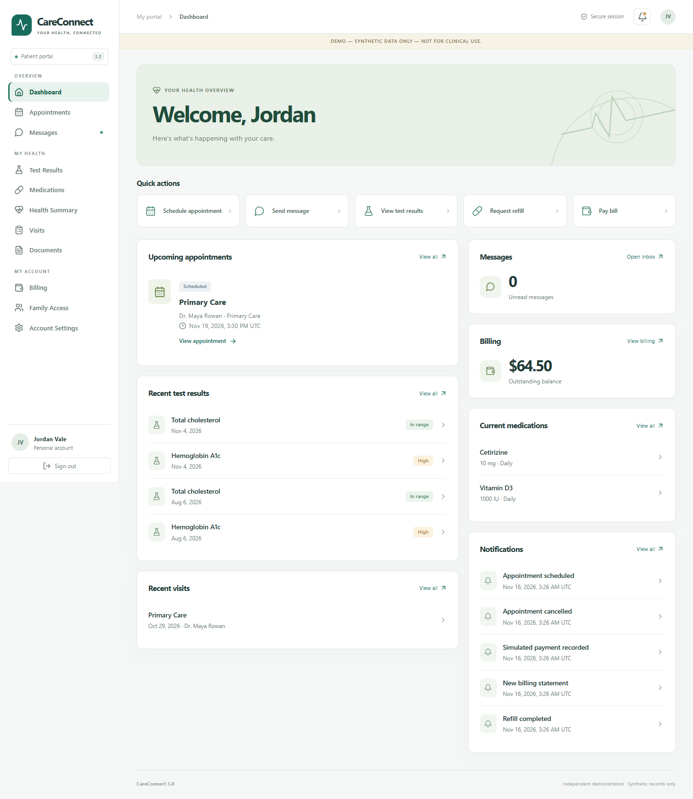
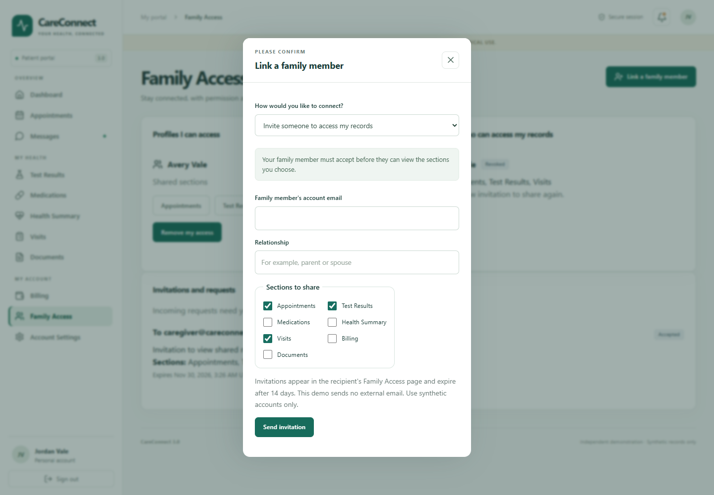
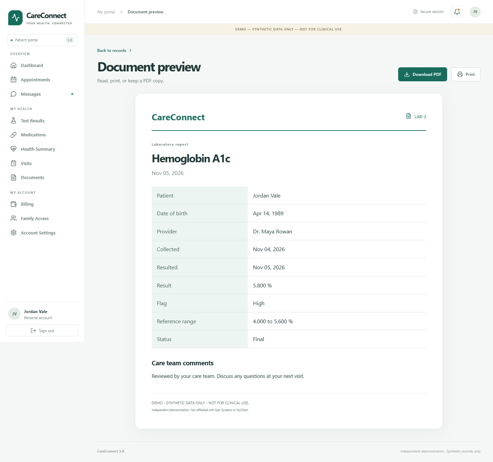
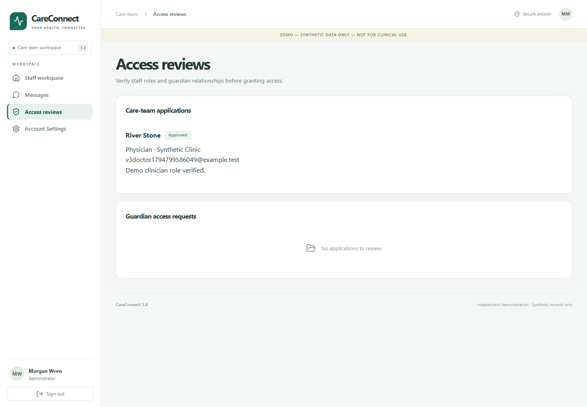

# CareConnect 3.0 · Your health, connected

**A working patient portal, family access hub, and simulated hospital workspace.**

CareConnect brings appointments, medical records, care-team conversations, medications, and bills into one place. Explore both sides of care: a patient makes a request, and hospital staff act on it in the same system.



<!-- LIVE_DEMO_START -->
**Live demo:** [Open website](https://careconnect-demo-rc0t.onrender.com) · [Sign in](https://careconnect-demo-rc0t.onrender.com/login) · [Create an account](https://careconnect-demo-rc0t.onrender.com/register)

No installation required. Use a demo account below or register your own test account. This free trial may take about a minute to wake after inactivity. Its free database expires on **December 16, 2026** unless upgraded.

[Deployment setup](docs/deployment.md) · [Screenshots](#a-look-inside) · [Demo accounts](#demo-accounts) · [Quick walkthrough](docs/manual-checklist.md)
<!-- LIVE_DEMO_END -->

**DEMO — SYNTHETIC DATA ONLY — NOT FOR CLINICAL USE.** This independent project is inspired by patient portal workflows and is not affiliated with Epic Systems or MyChart. Use invented names, emails, and records. Billing and prescriptions are simulations.

## What you can do

| Area | Try it in CareConnect |
| --- | --- |
| Appointments | Find a time, book, complete check-in, request a change, or cancel. |
| Messages | Talk to the care team, reply, archive, and restore conversations. |
| Test results | View released results and trends, read reports online, and download PDFs. |
| Medications | Request a refill and follow its progress through staff review. |
| Health records | Review conditions, allergies, visits, shared notes, and visit summaries. |
| Billing | Make simulated payments and view statements and PDF receipts. |
| Family Access | Invite or request access to a family member's records with consent and scoped permissions. |
| Hospital workspace | Manage requests, publish records, approve staff applications, and review family access. |

## Demo accounts

Open the [live sign-in page](https://careconnect-demo-rc0t.onrender.com/login) and use any account below. These also work in a fresh local installation.

**Shared demo password: `CareConnect-Demo-2026!`**

| Username | Role | Best place to start |
| --- | --- | --- |
| `patient` | Patient · Jordan Vale | Dashboard, appointments, results, and bills |
| `caregiver` | Family caregiver · Taylor Vale | Family Access → Link a family member |
| `physician` | Physician · Maya Rowan | Staff workspace and care-team messages |
| `admin` | Administrator · Morgan Wren | Staff workspace and Access reviews |
| `nurse` | Nurse | Clinical workflows |
| `frontdesk` | Front Desk | Scheduling |
| `billing` | Billing Staff | Invoices and payments |
| `dependent` | Patient · Avery Vale | Linked family profile example |

Shared accounts use the same demonstration data for every visitor. Please leave their passwords unchanged. A demonstration administrator can manage synthetic patient records; creating an account here does not make it a private medical service.

**Prefer your own account?** Choose **Create an account** on the sign-in page, then **Patient**, **Family caregiver**, or **Care team**. Patients and caregivers can sign in immediately; care-team applications require administrator approval. New accounts start with their own empty records. Use a unique invented email such as `your-demo-name@example.test` and a password you do not use elsewhere. Real email delivery is not enabled.

For a short two-sided tour, use `patient` in a normal browser window and `admin` in a private window. Send a message or request a refill as the patient, process it as staff, then return to the patient view. Separate browser sessions prevent the accounts from replacing each other's login.

## A look inside

### Choose how you want to use the portal


### Link family records with permission



### Read online, print, or download a PDF



Sample exports: [lab report](docs/pdf-samples/lab.pdf) · [visit summary](docs/pdf-samples/document.pdf) · [statement](docs/pdf-samples/invoice.pdf) · [receipt](docs/pdf-samples/receipt.pdf).

### Review requests from the hospital side



Mobile layouts and more views are available in the [screenshot gallery](docs/screenshots-v3).

## Browser evaluation

An AI-assisted evaluation ran **100 browser tasks** against the public website: 23 simple, 47 medium, and 30 hard. The corrected functional-test result was **99 passed / 100 (99%)**; public password recovery remains unavailable because email delivery is not configured. First scripted attempts scored **69/100**, including test-harness errors and blocked prerequisites. All original attempts and test-only corrections are disclosed; the website implementation was not changed during testing.

[100 task definitions](experiments/ai-browser-100/TASKS.md) · [Results and screenshots](experiments/ai-browser-100/REPORT.md) · [CSV](experiments/ai-browser-100/tests-and-results.csv) · [Runnable browser suites](frontend/ai-tests) · [Methodology and limitations](experiments/ai-browser-100/AGENT-NOTES.md)

The agents used Playwright browser automation with visible controls and DOM assertions, not a screenshot-only desktop computer-use tool. Results apply to the specified tasks and do not imply complete security or production readiness.

## Architecture

Version 3 adds account-type registration and administrator-reviewed care-team applications, consent-based family linking, explicit message restoration, and website previews with real PDF downloads. It retains the version-2 interface around manual-test feedback: searchable staff work areas, immediate record drawers, clear patient context, reliable sign-out, readable errors, password confirmation and recovery. All interface copy and seeded records are in English.

React, TypeScript, Vite, Tailwind CSS, React Router and TanStack Query power the interface. Django and Django REST Framework handle authenticated sessions, CSRF, role checks, patient and proxy scoping, validation and persisted audit events. Local development uses SQLite. Production settings support PostgreSQL. Vite proxies API calls to Django, keeping browser requests same-origin during local development.

## Run locally

Use Python 3.12 or later, Node.js 22 or later and pnpm 11. Run from the repository root.

```powershell
python -m venv .venv
.\.venv\Scripts\Activate.ps1
python -m pip install -r backend/requirements.txt
python backend/manage.py migrate
python backend/manage.py seed_demo
python backend/manage.py runserver 127.0.0.1:18270
```

On macOS and Linux, activate with `source .venv/bin/activate`. In a second terminal, run the frontend.

```sh
cd frontend
pnpm install --frozen-lockfile
pnpm dev --host 127.0.0.1
```

Open [CareConnect 3.0 locally](http://127.0.0.1:15270). Vite uses a strict dedicated port, failing visibly if occupied instead of silently opening another app. The second patient demonstrates scoped proxy access. Rerunning the seed command preserves edits and uses the current date when creating demo availability. To start fresh, set `CC_SQLITE` to a new writable SQLite path before migrating and seeding.

Use the [demo accounts above](#demo-accounts). Set `CC_DEMO_PASSWORD` before first seeding to use another password. Production mode disables seeding unless `CC_PUBLIC_DEMO=1` explicitly enables a synthetic demonstration deployment.

## Password recovery

Choose **Forgot password?**, enter a seeded email such as `patient@careconnect.example`, then open **Demo mailbox**. The reset link expires after 30 minutes and works once. A newer reset request or password change invalidates older links. New-password confirmation and Django password-strength validation are required. Resetting a password invalidates existing authenticated sessions.

This mailbox is a local simulation for synthetic accounts. Messages go to the requesting browser's server-side session, without real email delivery or proof of address ownership. Other browser sessions cannot read that mailbox. It is disabled in production; production recovery returns a configuration error until real delivery is implemented. Recovery endpoints have CSRF protection and local, per-process rate limits.

## Configuration and deployment

The [Render deployment guide](docs/deployment.md) explains how to publish the complete application. The repository includes a Docker image definition, a Render Blueprint, and same-origin frontend/API serving with Gunicorn and WhiteNoise. PostgreSQL keeps accounts and records separate from the web service's temporary filesystem. Render provides the HTTPS address after deployment.

The included Blueprint selects free instances for a short trial; Render's free database expires after 30 days. Review the host's pricing and choose paid compute/database plans for a lasting showcase. Hosting is not activated by pushing this repository to GitHub.

See [.env.example](.env.example) for configuration. The hosted demo runs with debug disabled, secure cookies, explicit synthetic seeding, and the local password-reset mailbox disabled. Real email recovery is not yet configured.

## Verification

```sh
python -m pytest -q
python backend/manage.py check
python backend/manage.py makemigrations --check --dry-run
cd frontend
pnpm test
pnpm build
pnpm exec playwright install chromium
pnpm e2e
```

Playwright expects the two local services running with default seeded credentials. Use a disposable seeded database because browser tests write synthetic records. Optionally set `CC_BROWSER_BIN` to an installed Chromium binary.

Complete release requirements: [Version 2.0](experiments/round-02/description.md) · [Version 3.0](experiments/round-03/description.md). Each document is self-contained and organized by product capability, with business rules and acceptance criteria.

See [Round 3 results](experiments/round-03/results.md), and [v3 feedback decisions](docs/v3-feedback.md). Previous [Round 2 results](experiments/round-02/results.md), [feedback decisions](docs/v2-feedback.md), and the [short manual checklist](docs/manual-checklist.md). [Round 1 results](experiments/round-01/results.md) remain available.

## Known limits

PDF reports, statements and receipts are generated locally with ReportLab. Family invitations are delivered in-app to synthetic accounts; email ownership and real-world staff/guardian identity are not verified by this demo. Administrators record a simulated verification decision. Production use would require verified enrollment and real delivery. Message attachments, external email and SMS, scheduled appointment reminders, live telehealth, live payment processing and electronic prescription transmission are outside this implementation. Appointment slots represent exact start times. Staff permissions apply by department function or message team and use the synthetic patient directory. This prototype has not undergone clinical, production security, accessibility or compliance certification.

## Versioning

Version 3 uses Git tag `v3.0.0` and development branch `version-3`. Version 2 remains available as `v2.0.0`. Round 1 is preserved as `v0.1.0-r1`. The original brief remains under `experiments/round-01/`; v2 complete requirements and validation are under `experiments/round-02/`.

## Registration, family linking, and PDFs

Create an account starts with Patient, Family caregiver, or Care team. Care-team applicants must receive administrator approval through **Access reviews**. A pending account cannot access staff APIs. Seeded staff accounts are already authorized. Administrator accounts are never offered in public registration.

**Family Access → Link a family member** offers invitations, access requests, and guardian review. Requests expire after 14 days. The recipient accepts in their own account; no email/name match alone grants access. Guardian requests require an administrator verification note. Shared access can be revoked, and a new request is needed to restore it. A family member who has not registered yet can use the invitation email when creating an account. The demo does not verify control of that email address. Use synthetic identities only.

**View report**, **Documents**, **View statement**, and payment receipts open a consistent web preview. **Download PDF** returns a genuine PDF and **Print** opens the browser print dialog. PDF endpoints enforce the same patient, publication and section permissions as the portal. Use the PDF for a paginated copy with page numbers.
