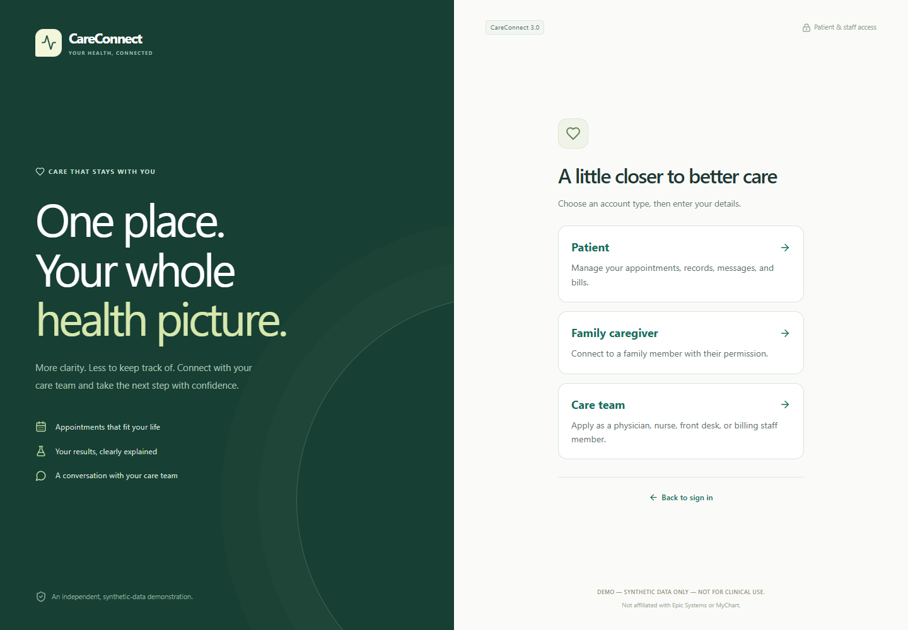

# CareConnect 3.0

**DEMO — SYNTHETIC DATA ONLY — NOT FOR CLINICAL USE.**

CareConnect is an independent research prototype inspired by patient portal workflows. It has no affiliation with Epic Systems or MyChart. Synthetic billing, prescriptions, and communications are stored locally.

## Features

Patients can manage appointments, check in, send messages, review published laboratory trends, request medication refills, review their health summary and visits, pay synthetic bills, download documents and receipts, switch to authorized family records, and manage notification preferences. Employees use the same portal sign-in and see a role-based workspace for scheduling, clinical records, publication, billing and proxy administration.

## Architecture

Version 3 adds account-type registration and administrator-reviewed care-team applications, consent-based family linking, explicit message restoration, and website previews with real PDF downloads. It retains the version-2 interface around manual-test feedback: searchable staff work areas, immediate record drawers, clear patient context, reliable sign-out, readable errors, password confirmation and recovery. All interface copy and seeded records are in English.



React, TypeScript, Vite, Tailwind CSS, React Router and TanStack Query power the interface. Django and Django REST Framework handle authenticated sessions, CSRF, role checks, patient and proxy scoping, validation and persisted audit events. Local development uses SQLite. Production settings support PostgreSQL. Vite proxies API calls to Django, keeping browser requests same-origin during local development.

## Run locally

Use Python 3.12 or later, Node.js 22 or later and pnpm 11. Run from the repository root.

```powershell
python -m venv .venv
.\.venv\Scripts\Activate.ps1
python -m pip install -r backend/requirements.txt
python backend/manage.py migrate
python backend/manage.py seed_demo
python backend/manage.py runserver 127.0.0.1:18270
```

On macOS and Linux, activate with `source .venv/bin/activate`. In a second terminal, run the frontend.

```sh
cd frontend
pnpm install --frozen-lockfile
pnpm dev --host 127.0.0.1
```

Open [CareConnect 3.0 locally](http://127.0.0.1:15270). Vite uses a strict dedicated port, failing visibly if occupied instead of silently opening another app. The second patient demonstrates scoped proxy access. Rerunning the seed command preserves edits and uses the current date when creating demo availability. To start fresh, set `CC_SQLITE` to a new writable SQLite path before migrating and seeding.

| Username | Role |
| --- | --- |
| patient | Patient, Jordan Vale |
| dependent | Patient, Avery Vale |
| caregiver | Family caregiver, Taylor Vale |
| physician | Physician |
| nurse | Nurse |
| frontdesk | Front Desk |
| billing | Billing Staff |
| admin | Administrator |

The default local password is `CareConnect-Demo-2026!`. Set `CC_DEMO_PASSWORD` before first seeding to use another password. Production mode disables the seed command.

## Password recovery

Choose **Forgot password?**, enter a seeded email such as `patient@careconnect.example`, then open **Demo mailbox**. The reset link expires after 30 minutes and works once. A newer reset request or password change invalidates older links. New-password confirmation and Django password-strength validation are required. Resetting a password invalidates existing authenticated sessions.

This mailbox is a local simulation for synthetic accounts. Messages go to the requesting browser's server-side session, without real email delivery or proof of address ownership. Other browser sessions cannot read that mailbox. It is disabled in production; production recovery returns a configuration error until real delivery is implemented. Recovery endpoints have CSRF protection and local, per-process rate limits.

## Configuration and deployment

See `.env.example` for process environment variables. For a production-style deployment configure PostgreSQL and set `CC_PRODUCTION=1`, `CC_SECRET_KEY`, database credentials, allowed hosts and the HTTPS trusted origin. Build the frontend and serve its output with SPA fallback for browser navigation and an HTTPS same-origin reverse proxy to Django for `/api/`. This repository provides local startup and production configuration, with hosting and infrastructure left to the deployer.

## Verification

```sh
python -m pytest -q
python backend/manage.py check
python backend/manage.py makemigrations --check --dry-run
cd frontend
pnpm test
pnpm build
pnpm exec playwright install chromium
pnpm e2e
```

Playwright expects the two local services running with default seeded credentials. Use a disposable seeded database because browser tests write synthetic records. Optionally set `CC_BROWSER_BIN` to an installed Chromium binary.

See [v3 consolidated prompt](experiments/round-03/description.md), [Round 3 results](experiments/round-03/results.md), and [v3 feedback decisions](docs/v3-feedback.md). Previous [Round 2 results](experiments/round-02/results.md), [feedback decisions](docs/v2-feedback.md), and the [short manual checklist](docs/manual-checklist.md). [Round 1 results](experiments/round-01/results.md) remain available.

## Known limits

PDF reports, statements and receipts are generated locally with ReportLab. Family invitations are delivered in-app to synthetic accounts; email ownership and real-world staff/guardian identity are not verified by this demo. Administrators record a simulated verification decision. Production use would require verified enrollment and real delivery. Message attachments, external email and SMS, scheduled appointment reminders, live telehealth, live payment processing and electronic prescription transmission are outside this implementation. Appointment slots represent exact start times. Staff permissions apply by department function or message team and use the synthetic patient directory. This prototype has not undergone clinical, production security, accessibility or compliance certification.

## Versioning

Version 3 uses Git tag `v3.0.0` and development branch `version-3`. Version 2 remains available as `v2.0.0`. Round 1 is preserved as `v0.1.0-r1`. The original brief remains under `experiments/round-01/`; v2 scope and validation are under `experiments/round-02/`.

## Registration, family linking, and PDFs

Create an account starts with Patient, Family caregiver, or Care team. Care-team applicants must receive administrator approval through **Access reviews**. A pending account cannot access staff APIs. Seeded staff accounts are already authorized. Administrator accounts are never offered in public registration.

**Family Access → Link a family member** offers invitations, access requests, and guardian review. Requests expire after 14 days. The recipient accepts in their own account; no email/name match alone grants access. Guardian requests require an administrator verification note. Shared access can be revoked, and a new request is needed to restore it. A family member who has not registered yet can use the invitation email when creating an account. The demo does not verify control of that email address. Use synthetic identities only.

**View report**, **Documents**, **View statement**, and payment receipts open a consistent web preview. **Download PDF** returns a genuine PDF and **Print** opens the browser print dialog. PDF endpoints enforce the same patient, publication and section permissions as the portal. Use the PDF for a paginated copy with page numbers.
